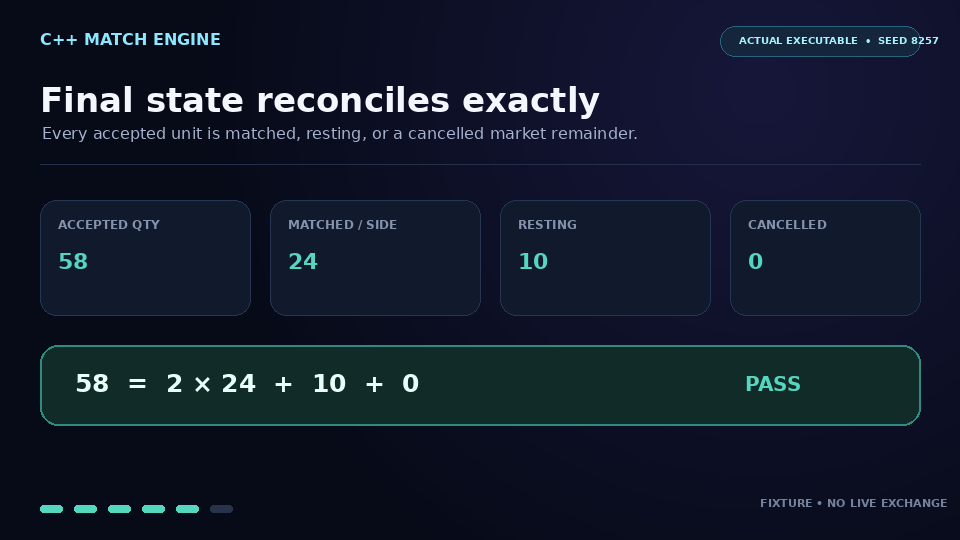
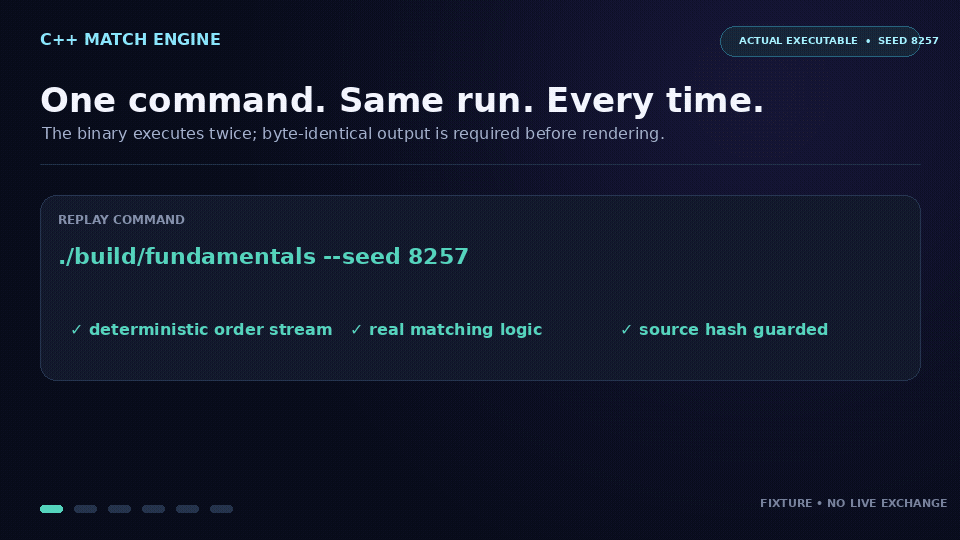

# High-Performance C++ Order Book & Matching Engine Simulator

[](https://isocpp.org/)
[](https://img.shields.io/badge/Platform-macOS%20%7C%20Linux-lightgrey.svg)
## Overview

This project implements a high-performance simulation of a financial exchange's core components: an **Order Book** and a **Matching Engine**, developed in C++. It serves as a practical demonstration of C++ programming skills, data structure design, and algorithmic implementation relevant to **quantitative finance** (market microstructure, low-latency systems) and general **software engineering**.

The simulator processes sequences of buy and sell orders (`LIMIT` and `MARKET`), maintains an accurate order book state reflecting price-time priority, executes trades by matching aggressive orders against resting liquidity, and logs all resulting trade executions.

## Demo

[](demo/matching-engine.mp4)



This 11-second walkthrough is generated from the actual executable running
`./build/fundamentals --seed 8257`. It shows FIFO fills, duplicate and
nonpositive ID rejection, the final book, and quantity reconciliation. The
input is a deterministic local fixture: it does not connect to an exchange or
make latency or trading-performance claims. See
[`demo/actual-output.txt`](demo/actual-output.txt) for the captured stdout and
[`demo/capture.json`](demo/capture.json) for artifact hashes and evidence.

## Core Components & Logic

* **Order Representation:** Defines `Order` structs encompassing essential details: ID, Side (Buy/Sell), Type (Limit/Market), Price, Quantity, and Timestamp.
* **Order Book (`OrderBook` Class):**
    * Manages separate Bid (Buy) and Ask (Sell) sides using `std::map<double, std::list<Order>>`.
    * Ensures **price-time priority**:
        * Maps are sorted by price (Bids: descending, Asks: ascending).
        * `std::list` within each price level maintains FIFO (First-In, First-Out) order arrival sequence.
    * Provides interfaces for adding limit orders and querying the Top-of-Book (Best Bid/Ask).
* **Matching Engine (`MatchingEngine` Class):**
    * Orchestrates the interaction between incoming orders and the `OrderBook`.
    * **Limit Order Processing:** Attempts to match against the opposite side if the order crosses the spread. Unmatched quantity rests in the book.
    * **Market Order Processing:** Immediately matches against the best available price levels on the opposite side until the order is filled or liquidity is exhausted. Unfilled quantity is cancelled.
    * Generates `Trade` records detailing each execution (aggressor/resting IDs, price, quantity, timestamp).
* **Simulation Driver:** Includes a sample order generator (`generateSampleOrders`) and a `main` function to instantiate components, process orders sequentially, and display final book state and trade logs.

## Technology & Build

* **Language:** C++ (utilizing C++11 features like `enum class`, `auto`, range-based `for`, `chrono`).
* **Compiler:** Tested with `clang++` (macOS) and compatible with `g++`. Requires C++11 standard support.
* **Standard Library:** Leverages STL containers (`map`, `list`, `vector`) and algorithms (`min`).
* **Build:** Dependency-free Make targets for the simulator and regression suite.

## Getting Started

### Prerequisites

* A C++ compiler supporting `-std=c++11` or newer (e.g., `clang++` or `g++`).
    * *macOS:* Install Xcode Command Line Tools (`xcode-select --install`).
    * *Linux (Debian/Ubuntu):* `sudo apt update && sudo apt install build-essential`
* Git.

### Build and run

```bash
git clone https://github.com/jadenfix/cpp_fundamentals.git
cd cpp_fundamentals
make
./build/fundamentals
```

The simulation prints incoming orders, executions, final bid/ask levels, and the
trade log. The sample stream is random; the regression tests use fixed orders.

For a reproducible end-to-end run:

```bash
./build/fundamentals --seed 8257
```

Seeded mode uses a deterministic fixture, omits wall-clock timestamps from its
output, and prints a final conservation check. Default invocation remains the
original random sample mode.

You can also build directly without Make:

```bash
c++ -std=c++11 -O2 -Wall -Wextra -Wpedantic fundamentals.cpp -o /tmp/fundamentals
/tmp/fundamentals
```

### Validate the matching engine

```bash
make test
make verify-demo
make clean test CXXFLAGS='-std=c++11 -O1 -g -Wall -Wextra -Wpedantic -fsanitize=undefined -fno-sanitize-recover=all'
```

Tests exercise both sides of the book, price and FIFO priority, partial fills,
limit residuals, market-order liquidity exhaustion, cancellation, and invalid
prices. They also verify that accepted order IDs are positive and unique for the
engine session and that seeded CLI output is byte-for-byte deterministic. Limit
prices must be finite and positive before they can match or rest.
CI builds and tests on Linux and macOS.

To regenerate the media, install Pillow and FFmpeg, then run
`python3 demo/render_demo.py`. The renderer validates the captured source hash,
builds the simulator, executes the same seed twice, requires identical output,
and checks every displayed fact before creating the GIF and MP4.

### Scope and next steps

This is a single-threaded educational simulator. Prices use floating point,
order IDs are caller-assigned, cancellation scans the book, and there is no
persistence, exchange connectivity, or measured latency guarantee. For an
exchange implementation, integer tick prices, indexed cancellation, and a
durable replay log would be practical next steps.
